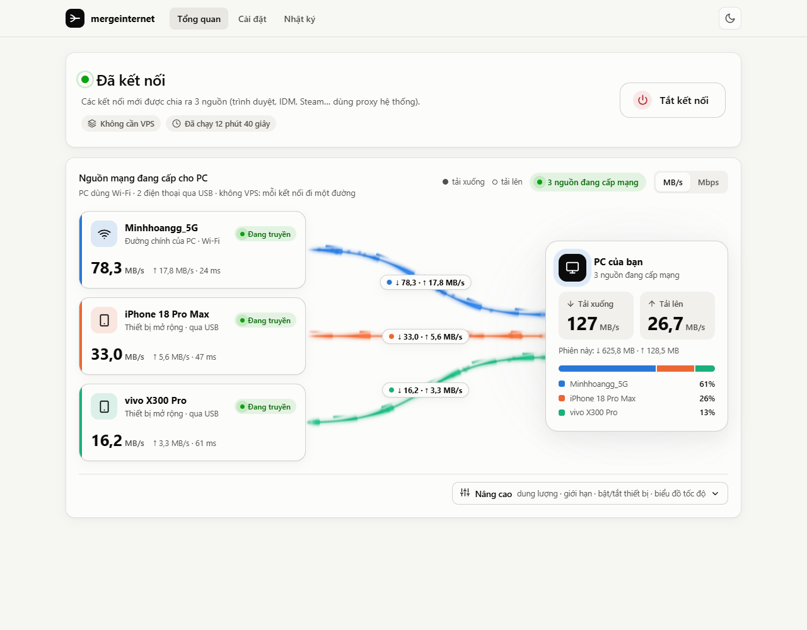
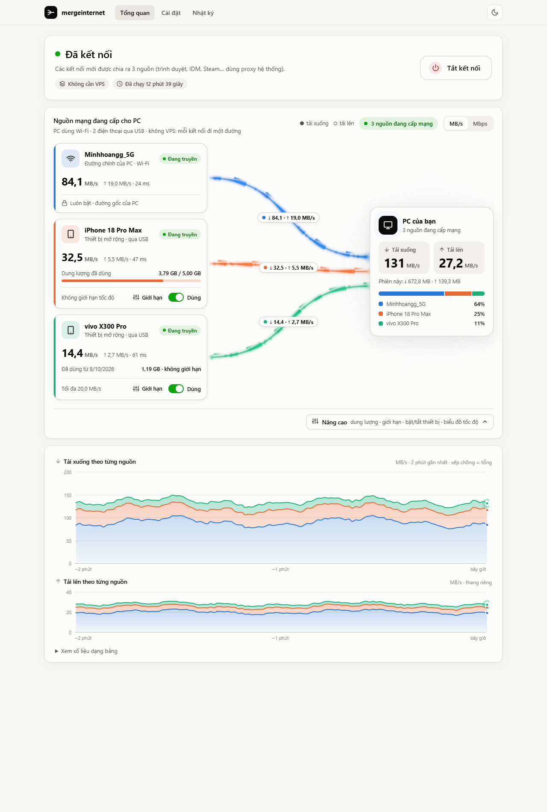

# mergeinternet

Gộp internet của PC (Wi-Fi/LAN) với tối đa 5 điện thoại (USB hoặc Wi-Fi hotspot) trên Windows. **Bấm một nút là chạy.**

| | **Không cần VPS** (mặc định) | **Qua VPS** (tuỳ chọn) |
|---|---|---|
| Cách gộp | mỗi **kết nối** đi một đường (như plexo) | mỗi **gói tin** đi một đường, ráp lại ở VPS |
| Tải nhiều luồng (IDM, trình duyệt, Steam, torrent) | nhanh hơn | nhanh hơn |
| Một kết nối đơn (gọi video, game, tải 1 luồng) | không nhanh hơn | nhanh hơn |
| Cần gì | không cần gì, không cần quyền Admin | một VPS Linux (khoảng 100–150k/tháng) + quyền Admin |
| Thiết lập | nút **Bắt đầu ngay** | nhập IP và mật khẩu VPS, app tự cài |

> **Vì sao chế độ VPS cần máy chủ ở ngoài, và không thể dùng WSL hay máy ảo?** Mỗi đường ra internet bằng một IP khác nhau. Muốn một kết nối đơn dùng được cả 3 đường, các gói phải gặp lại nhau ở một điểm *phía sau* cả 3 nhà mạng. WSL hay máy ảo chạy *trong* PC nên vẫn ra internet qua đúng các nhà mạng đó. Đã đo trên máy dev: IP công cộng nhìn từ WSL trùng với IP nhìn từ Windows.

## Dùng ngay

1. Cắm điện thoại qua USB và bật chia sẻ mạng:
   - **Android:** *Điểm phát sóng → Chia sẻ Internet qua USB*.
   - **iPhone:** cài **Apple Devices** (Microsoft Store) để có driver; bật *Điểm truy cập cá nhân*, cắm cáp, chọn *Tin cậy*.
   - Hoặc, khi PC đang cắm LAN, cho PC bắt **Wi-Fi hotspot** của điện thoại, hoặc **một mạng Wi-Fi khác** (nhà mạng khác, router khác).
   - PC cắm LAN và bắt thêm Wi-Fi thì cả hai đều được dùng: LAN là đường chính, Wi-Fi là "mạng mở rộng". Khi đo tốc độ, app hỏi Cloudflare IP công cộng của từng đường. Nếu Wi-Fi ra internet cùng IP với LAN (tức cùng router), thẻ của nó hiện **Trùng mạng**, vì gộp hai đường đó không tăng tốc.
2. Nhấp đúp **`bin\mi-client.exe`**. Bảng điều khiển mở trong trình duyệt.
3. Bấm **Bắt đầu ngay**. App tự làm phần còn lại:
   - tìm Wi-Fi/LAN và các điện thoại (kèm tên máy, ví dụ "vivo X300 Pro");
   - đo tốc độ thật từng đường (qua máy chủ speedtest của Cloudflare);
   - đặt proxy hệ thống của Windows và bắt đầu chia kết nối.

| Đang kết nối | Nâng cao |
|---|---|
|  |  |

Màn hình chính là **sơ đồ nguồn → PC**, vẽ bằng WebGL (three.js, nhúng sẵn trong app nên không cần mạng):
- xung sáng ↓ chạy vào PC, xung ↑ chạy ra;
- thẻ PC hiện tổng ↓ tải xuống và ↑ tải lên.

Bấm **Nâng cao** để hiện thêm:
- dung lượng, giới hạn tốc độ và công tắc trên từng thẻ thiết bị;
- biểu đồ tốc độ 2 phút gần nhất (↓ và ↑, mỗi biểu đồ có thang riêng);
- bảng số liệu.

Điện thoại đã lưu nhưng đang không kết nối (rút cáp, tắt hotspot) được ẩn khỏi màn hình. Khi kết nối lại, nó tự hiện lên.

Khi đang chạy:
- Cắm thêm điện thoại thì app **tự thêm và tự đo** (có thể tắt trong Cài đặt).
- Mỗi điện thoại có công tắc **Dùng**, và nút **Giới hạn** để đặt tốc độ tối đa và dung lượng tối đa. Hết dung lượng thì máy đó tự ngắt; số liệu lưu trong `usage.json`.
- **Tắt kết nối** hoặc đóng cửa sổ console thì proxy Windows trở lại như cũ. Nếu app bị tắt đột ngột (kill trong Task Manager, crash), một tiến trình canh nhỏ (`mi-client.exe guard`) trả proxy về như cũ trong khoảng 1 giây. Lần mở sau app cũng kiểm tra lại.
- Kết nối mới được chia theo tốc độ đo được: đường nhanh gánh phần lớn, điện thoại nhận thêm khi có nhiều kết nối cùng lúc. Đo thật trên máy dev với 6 luồng tải song song: Wi-Fi 822 Mbps chở 40 MB, vivo 150 Mbps chở 8 MB. Mở từng trang lẻ thì gần như chỉ đi Wi-Fi, vì đó là đường nhanh nhất.

Tuỳ chọn trong **Cài đặt → Chế độ kết nối**: tự bật khi mở app, khởi động cùng Windows (chạy nền; mở lại exe để thấy bảng điều khiển), tự thêm điện thoại, và "mỗi trang web dùng 1 đường" (đăng nhập ổn định hơn).

### Ứng dụng nào được tăng tốc ở chế độ không VPS?

Những app dùng **proxy hệ thống của Windows**: Edge, Chrome và hầu hết app trên desktop. Một số app có cài đặt proxy riêng, ví dụ IDM (Options → Proxy) hay client torrent; với những app đó, đặt HTTP proxy `127.0.0.1:7879` hoặc SOCKS5 `127.0.0.1:7880`. Windows Update và game dùng UDP không đi qua proxy.

## Chế độ VPS (tuỳ chọn)

Trong màn hình đầu (hoặc **Cài đặt → Cài / nâng cấp VPS…**):
- **Cài VPS tự động:** nhập IP và mật khẩu root mà nhà cung cấp gửi cho bạn. App SSH vào VPS, cài `mi-server`, mở cổng UDP, lấy key, đo tốc độ rồi bật. Mật khẩu chỉ dùng một lần và không được lưu. Lần đầu app ghi nhớ "dấu vân tay" của VPS và sẽ từ chối nếu nó thay đổi.
- **Mã kết nối:** nếu bạn tự chạy `deploy/server-setup.sh` trên VPS, script in ra một dòng `mi1:IP:PORT:KEY`; dán dòng đó vào app là xong.

Chế độ VPS cần quyền Administrator để tạo card mạng ảo. Bấm **Bật kết nối** rồi chọn Yes là app tự mở lại với quyền đó và kết nối luôn.

<details><summary>Cài VPS bằng tay</summary>

```bash
scp bin/mi-server bin/server-setup.sh root@VPS_IP:/root/
ssh root@VPS_IP 'cd /root && bash server-setup.sh'   # in ra "MÃ KẾT NỐI: mi1:..."
```
</details>

## Build

```powershell
powershell -ExecutionPolicy Bypass -File scripts\build.ps1      # test + bin\mi-client.exe, bin\mi-server-linux-{amd64,arm64}
powershell -ExecutionPolicy Bypass -File scripts\get-wintun.ps1 # bin\wintun.dll (chỉ cần cho chế độ VPS)
```

> Xem thử giao diện: chạy `mi-client.exe`, rồi mở `http://127.0.0.1:7878/?demo=case3` (hoặc `case1`, `case2`, `candidate`, `fresh`, `stopped`).

## Giới hạn đã biết

- **Không VPS:** một kết nối đơn chỉ đi một đường. Website thấy IP khác nhau giữa các kết nối, nên một số trang (ngân hàng…) có thể bắt đăng nhập lại; bật "mỗi trang web dùng 1 đường" nếu gặp. Có thể Chrome/Edge gửi một phần lưu lượng QUIC (UDP) trực tiếp, không qua proxy (chưa kiểm chứng).
- **Đo tốc độ** dùng khoảng vài chục MB dữ liệu mỗi điện thoại, mỗi lần đo (lần đầu và khi cắm máy mới).
- **Tối đa 5 điện thoại** cộng 1 đường chính:
  - Mỗi điện thoại cần SIM/data riêng; hai máy cùng nhà mạng ở cùng chỗ có thể chia nhau một trạm phát nên không cộng đủ tốc độ.
  - Cắm nhiều máy qua USB nên dùng hub có nguồn điện riêng.
  - PC chỉ có 1 card Wi-Fi thì bắt được tối đa 1 hotspot, và chỉ khi đường chính là LAN; các máy còn lại phải cắm USB.
  - Đã kiểm thử thật với 2 nguồn (Wi-Fi + vivo qua USB); cấu hình 5 máy mới chỉ chạy bằng unit test và bản demo giao diện.
- **VPS:** chỉ IPv4; nếu card 4G có IPv6 thì nên tắt IPv6 trên card đó (`Disable-NetAdapterBinding -Name "Ethernet 7" -ComponentID ms_tcpip6`). Độ trễ bằng đường chậm nhất. Một client cho mỗi server. Server phải cùng phiên bản với client. Tường lửa riêng của nhà cung cấp VPS (security group) phải mở cổng UDP 51820; app không tự mở được.
- **Nhận diện tên thiết bị:** đã kiểm chứng trên máy thật với Android qua USB và Wi-Fi nhà; chưa kiểm chứng với iPhone qua USB và hotspot thật. Hotspot của điện thoại được nhận ra qua dải IP của iPhone (172.20.10.x) hoặc tên SSID có tên hãng điện thoại; hotspot có tên SSID tự đặt sẽ được hiện là "mạng Wi-Fi thêm" (vẫn được dùng bình thường).

## Cấu trúc mã

```
cmd/mi-client       Windows: bảng điều khiển (mặc định), `run` = chế độ VPS không giao diện
cmd/mi-server       Linux VPS server
deploy/             server-setup.sh (nhúng vào app để cài VPS tự động)
internal/ui         bảng điều khiển web + thiết lập 1 nút, tự thêm thiết bị, tự đo
internal/client     chạy 2 chế độ (Tunnel = VPS, Local = không VPS) + quota/giới hạn dùng chung
internal/localproxy proxy HTTP/SOCKS5 chia kết nối theo đường + đo tốc độ qua Cloudflare
internal/sysproxy   đặt / khôi phục proxy hệ thống Windows (WinINet), có khôi phục sau crash
internal/provision  cài VPS qua SSH, đọc mã kết nối
internal/devinfo    nhận diện nguồn mạng: vai trò, cách nối, tên thiết bị
internal/engine     lõi tunnel VPS: mã hoá, chia gói, reorder, đo tốc độ, giới hạn
internal/{proto,sched,reorder,window,bindif,tunif,config}
```
